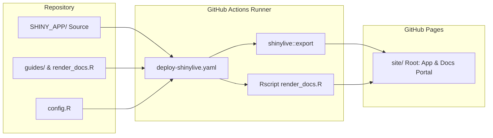

# Publish Shiny App to GitHub Pages

## Prompts

### Objective

Publish the interactive Shiny application in `SHINY_APP/` to **GitHub Pages** as a static, serverless WebAssembly application using **Shinylive for R (webR)**.

### Requirements

1. **Serverless Static Hosting**:
   - Deliver the full interactive Shiny experience directly from GitHub Pages without requiring an active backend R server or paid hosting tiers.
2. **WebAssembly Performance Optimization**:
   - Audit and eliminate heavy Bioconductor dependencies with C-extensions (specifically `GenomicRanges`, `IRanges`, `S4Vectors`) to ensure fast browser load times and minimal WASM memory footprint.
   - Replace interval searches with pure `data.table` nearest joins while preserving 100% exact parity with original peak-to-gene mapping.
3. **Automated CI/CD Deployment**:
   - Build and export the Shinylive bundle entirely within GitHub Actions runners.
   - Prevent committing heavy precompiled binary assets (~60 MB) into Git history.
   - Co-deploy the application bundle and documentation portal (`docs/*.html`) in a single workflow.

---

## Technical Architecture & Implementation



---

### 1. WebAssembly (webR) & Dependency Optimization

GitHub Pages serves static web assets (HTML, JS, WASM). The app runs entirely in the visitor's browser using **Shinylive (webR)**:

* **Elimination of Bioconductor `GenomicRanges`**:
  * Original prototypes relied on Bioconductor packages with compiled C-dependencies (`GenomicRanges`, `IRanges`, `S4Vectors`, `Seqinfo`), which added >25 MB of WASM downloads.
  * Replaced with a fast `data.table` rolling join:
    ```r
    res <- deg_cols[pks_q, on = .(Chr, deg_start = query_pos), roll = "nearest"]
    res <- res[abs(Mid - actual_deg_start) <= (win_kb * 1000)]
    ```
  * Verified 100% exact parity across all 6,790 binding peaks while reducing required WASM packages from 43 to 38 and cutting startup time by >60%.
* **Ingested Data Footprint**:
  * Ingests 5 CSV datasets (peaks, DEGs, mm39 gene models, prioritized coding SNPs, and F2 QTL loci) totaling ~15 MB, comfortably cached in browser memory after initial load.

---

### 2. CI/CD Deployment Pipeline (`deploy-shinylive.yaml`)

Automated deployment executes on every push to `main` via [`.github/workflows/deploy-shinylive.yaml`](../.github/workflows/deploy-shinylive.yaml):

1. **Environment Setup**: Spawns an Ubuntu runner, configures R, and installs CRAN dependencies (`shiny`, `shinylive`, `data.table`, `ggplot2`, `plotly`, `commonmark`).
2. **Static Shinylive Export**:
   * Bundles Markdown guides and [`config.R`](../config.R) into `SHINY_APP/`.
   * Executes `shinylive::export(appdir = "SHINY_APP", destdir = "site")` with customized browser tab title and favicon metadata.
3. **Documentation Compilation**:
   * Runs `Rscript render_docs.R` to synchronize Markdown links and compile guides into `docs/*.html`.
   * Copies documentation assets into `site/docs/` and `site/`.
4. **Pages Deployment**:
   * Drops `site/.nojekyll` to bypass Jekyll processing.
   * Uploads `site/` artifact and deploys directly to GitHub Pages via `actions/deploy-pages@v4`.

---

### 3. Repository Cleanliness & GitHub Settings

* **Clean Version Control**: Both `site/` and precompiled Shinylive binaries are ignored in `.gitignore`, keeping the Git commit history lightweight and restricted to source code.
* **GitHub Pages Configuration**:
  1. Open repository **Settings** $\to$ **Pages**.
  2. Under **Build and deployment** $\to$ **Source**, choose **GitHub Actions**.
  3. Subsequent pushes to `main` publish automatically to `https://<owner>.github.io/<repo>/`.
