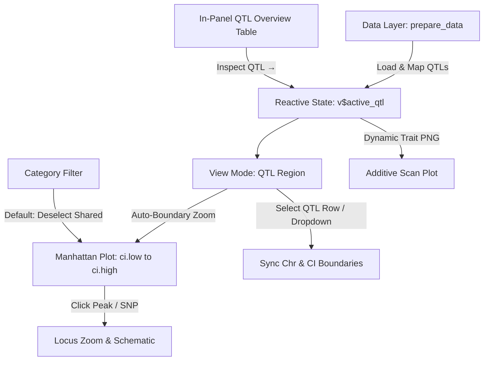

# QTL Analysis Updates to App

This is based on analysis reported in the (currently private) repo
[https://github.com/AttieLab-Systems-Genetics/Vanderbilt](https://github.com/AttieLab-Systems-Genetics/Vanderbilt/tree/main/results).

## Prompts

* Develop implementation plan for QTL features and modifications to the app described below. Implement upon agreement.
* Develop a plan to incorporate `SHINY_APP/QTLresults` more fully into the app. Implement plan upon agreement. Details include:
  * Toggle between showing "Select F2 Glycemic QTL" and "Search Gene Symbol" based on whether "View Mode" is "QTL Region" or something else.
  * Modify as needed throughout app to find `Top_glycemic_QTL_for_sex_additive_analysis.csv` now in `QTLresults` folder.
  * Consider how to show this CSV file in main panel. For instance, having Select F2 Glycemic QTL" be blank as default for "View Mode: QTL Region" and then show the table in the main panel before a selection is made, hiding the table once selection is made. This would obviate the need for `QTLs` button in upper right.
  * Have way to reset selected peak for "QTL Region" to none; also, should reset to none when change QTL Region.
  * Optionally add scan for trait using PNGs in `QTLresults` folder. Traits beginning with "AUC" would use the *auc*png`files, with others using *traj*png` files. Pick file based on `Chr` for trait. Put this plot above the Peak Score plot, but have checkbox to "Hide Scan".  

## New QTL Features and Modifications

New feature: integrate loci identified in the F2 study, as listed in
`Top_glycemic_QTL_for_sex_additive_analysis.csv`.

We want to show this table and connect these QTL regions to other features.
For example, to zoom into the QTL on Chr16, I select view mode=chromosome, select chromosome=11, and then use the zoom tool for ~50 to 100Mbp. I then click on one of the triangles to highlight, yielding this view, where three genes are DE, all going up in the SJL backcrossed mice and proximal to a MAFA peak with SNPs.

Jumping from this locus on Chr16 to our QTL on 13, requires select chromosome 13 and then zoom for ~0 to 50Mbp, yielding this after clicking on a orange diamond (coding variant).

Since this type of query will be the focus on the app when integrating the QTL from the F2s, what would it take to include the QTL as another option for view mode? We could offer Chr and the corresponding CI for low and high as boundaries that will be displayed.

Finally, deselect “Shared” from the visible categories as the default.

---

## Technical Architecture & Implementation

---

### 1. Architectural Summary & Features

| Feature | Technical Implementation | User Impact |
| :--- | :--- | :--- |
| **QTL Data Ingestion** | Ingests `Top_glycemic_QTL_for_sex_additive_analysis.csv` from `QTLresults/`. Pre-calculates global Manhattan positions (`GlobalPos_Mbp`, `GlobalCI_Low_Mbp`, `GlobalCI_High_Mbp`) using Ensembl GRCm39 `chr_map`. | All 11 glycemic QTL loci across chromosomes 2, 3, 7, 11, 13, and 16 load at session start with zero Bioconductor runtime dependencies. |
| **"QTL Region" View Mode** | Added `"QTL Region"` to `selectInput("zoom_mode", ...)` alongside *Genome-Wide*, *Chromosome*, and dynamic *Locus Zoom*. | Provides dedicated, one-click access to QTL intervals without requiring manual box-zooming. |
| **Automated CI Bounding** | Automatically sets Manhattan x-axis boundaries to `[ci.low, ci.high]` (in Mbp) + 3% margin with dynamic local Mbp tick marks. | Eliminates manual navigation: selecting a Chr16 QTL immediately frames 50.87–96.88 Mb; selecting a Chr13 QTL frames 3.61–47.86 Mb. |
| **Visual Interval Cues** | Translucent blue rectangular banner across `[ci.low, ci.high]` and blue dashed line at the QTL peak position. | Active QTL interval is instantly recognizable on both *QTL Region* and *Chromosome* views. |
| **Dynamic Top-Nav Slot** | Primary input slot displays **"Select F2 Glycemic QTL"** in *QTL Region* mode and **"Search Gene Symbol"** in other modes. | Streamlines navigation by eliminating unnecessary dropdowns. |
| **Default Category Filter** | Defaults `input$show_cat` to `c("C57_Specific", "SJL_Specific", "Discordant")` with `"Shared"` deselected. | Strain-divergent peaks and variants stand out immediately on launch without being drowned out by thousands of shared non-divergent points. "Shared" can be re-enabled with one click. |
| **Peak-to-QTL Badge** | When a MafA peak resides within the active QTL CI, the metadata panel renders a prominent highlight card (`Within F2 QTL: [trait] (LOD [lod])`). | Directly connects molecular binding peaks to organismal glycemic traits. |

---

### 2. In-Panel Interactive Overview & Scan Integration

1. **In-Panel Overview Table**:
   - In `"QTL Region"` mode, the QTL selection defaults to blank (`""`), displaying a two-section overview in the main panel:
     - **AUC Glycemic Traits**: Renders `QTLresults/scan_auc_sex_additive_key_loci.png` followed by the interactive table of `AUC_gluc_*` trait peaks (`AUC_gluc_4wk`, `AUC_gluc_5wk`, `AUC_gluc_6wk`, `AUC_gluc_8wk`).
     - **Trajectory & Rate Traits**: Renders `QTLresults/scan_traj_sex_additive_key_loci.png` followed by the trajectory and rate trait table (`Slope_AUCs`, `AUC_8wk_minus_AUC_4wk`, and `AUC_of_AUCs`).
   - Two independent checkboxes (**"Hide AUC Key Loci Scan"** and **"Hide Trajectory Key Loci Scan"**) let users suppress either or both summary plots to minimize vertical scrolling.
   - Each row provides trait names, markers, chromosomes, peak positions, 95% CIs, LOD scores, additive effects ($BB$, $BS$, $SS$), and an **"Inspect QTL →"** button.
   - Clicking **"Inspect QTL →"** (or selecting a QTL from the top dropdown) hides the overview panel, frames the QTL confidence interval on the Manhattan plot, and activates the chromosome-specific trait scan plot.
   - A **"← Back to QTL Overview Table"** action link returns to the overview anytime.

2. **Additive Trait Scan Plots (`QTLresults/`)**:
   - Active QTLs display their corresponding additive scan plot from `QTLresults/` directly above the Manhattan plot:
     - Traits starting with `"AUC_gluc"` map dynamically to `scan_chr<Chr>_auc_sex_additive.png`.
     - Trajectory and compound traits (`Slope_AUCs`, `AUC_8wk_minus_AUC_4wk`, `AUC_of_AUCs`) map to `scan_chr<Chr>_traj_sex_additive.png`.
   - A **"Hide QTL Scan Plot"** checkbox in the Manhattan controls allows toggling scan visibility.

3. **Peak Selection & Deselection Mechanics**:
   - Entering `"QTL Region"` or changing QTL selection automatically resets the active peak (`v$active_pk <- NULL`).
   - An explicit **"✕ Deselect Current Peak"** button appears in the Manhattan Controls side panel immediately below the Hide Legend checkbox when a peak is active, providing intuitive deselection where peak selection originates and conditionally hiding the locus schematic and its controls.

4. **Continuous Control Card Stacking**:
   - Plots (Scan plot, Manhattan plot, and Locus Schematic) are housed in a 9-column left canvas.
   - Both control panels (**Manhattan Controls** followed immediately below by **Locus Schematic Controls**) are organized in a single continuous 3-column right sidebar. This ensures the schematic controls always follow immediately below the Manhattan controls, eliminating artificial vertical whitespace regardless of whether the QTL scan plot is visible.
