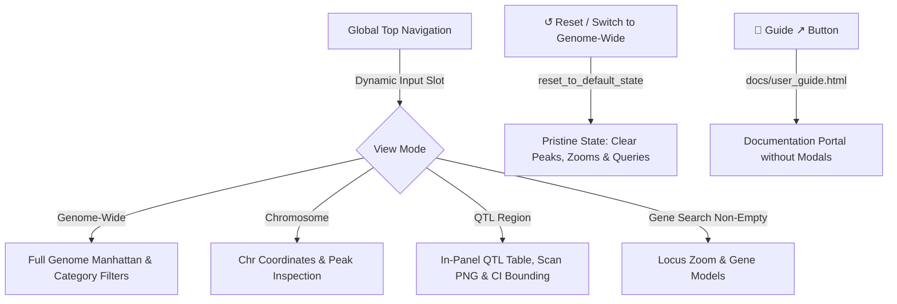

# Redesign of App

## Prompts

### Ideas to improve reactivity and navigation

* Hide "Select Chromosome:" when in "View Mode: Genome-Wide"
* "View Mode: Locus Zoom"
  * If "Search Gene Symbol:" is empty, main panel is blank.
  * Don't show "Locus Zoom" option until Gene Symbol is non-empty.
  * Once a "Gene Symbol" is selected, it appears.
  * If you then deselect "Search Gene Symbol", revert to whole genome and remove "Locus Zoom" from "View Mode".
* "Locus Window (Kbp):" this is only relevant when in "Locus Zoom"
  * Might be useful to have only selected set of values, say 20,50,100,200,500,1000,2000
* Top main panel initially has whole genome. When you "Select Gene Symbol":
  * "View Mode:" switches to "Locus Zoom"
  * X axis named as "Chromosome" with no Mbp ticks.
  * Want to be able to switch from "Locus Zoom" to "Chromosome" to the right chromosome easily.
* "Visible Categories:" is redundant given plotly ability to click on labels.
* "Min Peak Score:" consider selected values as for "Locus Window".

### Challenges with Interpreting

* Need explanation of both panels on "Locus Zoom".
  * This could be pop-up or pull-down.
  * Is top panel a subset of the "Chromosome" image?
* Reactive hiding and showing of side panel would simplify presentation
(see ideas above).

### Further Improvements

* Organize `{shinyapp,publishapp,redesign,qtlanalysis}.md` as a `Developer Guide` to be published via `docs/`.
* Fix `Reset` on app to reset everything, including selected gene.
* Move `Reset` and `Developer Guide` (new)buttons to below "Min phastCons Score:" slider.
* Detailed "Peak" information now on sidebar should go below last figure on main panel.

### More Improvements

* Change browser tab title from "Shiny App" to "MafA Discovery".
* Move controls from side panel next to plot
* Add plot-specific option(s) to hide legend
* Modify "Dev Guide" button on app to go to "<https://byandell.github.io/MafADiscovery/docs>", which would have `docs/index.html` that renders `developer_guide.md`
* Switching to "View Mode: Genome-Wide" should reset everthing.
* Add `guides/about.md` and link from `docs/index.html`.

## Future Considerations

* Panels rather than select
* Condense redesign.md

---

## Architectural Summary & Core Design Principles

1. **Top Global Navigation Bar**:
   - Houses brand title, dynamic primary selector (`search_gene` vs. `sel_qtl`), view mode dropdown (`zoom_mode`), contextual badge/selector slot, `📖 Guide ↗` direct link, and `↺ Reset`.
2. **Dynamic View Mode Lifecycle**:
   - **Genome-Wide**: Global Manhattan overview across all 19 autosomes + X.
   - **Chromosome**: Isolated single-chromosome Manhattan view with localized Mbp tick marks.
   - **QTL Region**: Automatically frames 95% Bayesian confidence intervals with dynamic trait scan PNG plots and in-panel QTL overview table.
   - **Locus Zoom**: Conditionally enabled only when a gene is actively queried; frames proximal gene models and coding polymorphisms in the micro schematic.
3. **Unified Canvas & Continuous Control Stacking**:
   - 9-column left canvas for plots (Additive Scan, Manhattan, Locus Schematic).
   - Continuous 3-column right sidebar stacking **Manhattan Controls** and **Locus Schematic Controls** without artificial row whitespace.
4. **State Auto-Reset Discipline**:
   - Switching to *"Genome-Wide"* or clicking `↺ Reset` invokes centralized `reset_to_default_state()`, clearing active peaks, SNP highlights, gene queries, and plot box-zooms while respecting mobile device legend preferences.
5. **Mobile-Responsive Optimization**:
   - Automatic client-side detection ($\le 768$px) defaults plot legends to hidden to preserve maximum canvas width on small displays.

---

## Chronological Implementation Record

### Phase 1: Core Reactivity & Control Modernization (Steps 1–10)
* **Step 1: Dynamic Locus Zoom Visibility**: Restricted "Locus Zoom" to appear in `zoom_mode` only when `search_gene` is non-empty; reverts to whole genome on gene clear.
* **Step 2: Chromosome Selector Reactivity**: Suppressed chromosome dropdown when in *Genome-Wide* view mode.
* **Step 3: Discrete Locus Window Stepper**: Replaced free numeric input with discrete increments (20, 50, 100, 200, 500, 1000, 2000 kb).
* **Step 4: Discrete Min Peak Score Stepper**: Provided stepped thresholding for peak scores.
* **Step 5: Coordinated Locus-to-Chromosome Navigation**: Maintained chromosome state when transitioning from locus view back to chromosome view.
* **Step 6: Manhattan Axis Labeling Polish**: Formatted chromosome axis ticks and titles cleanly across zoom transitions.
* **Step 7: In-App User Guide Modal**: Integrated `user_guide.md` interpretation modal with visual guidance for macro/micro panels.
* **Step 8: Global State Reset**: Wired `↺ Reset` to clear active peaks, selected genes, and zoom bounds.
* **Step 9: Relocated Controls & Metadata Placement**: Moved control buttons next to relevant plots and placed peak metadata below the primary visualizations.
* **Step 10: Dual Y-Axis Coding Variant Glyphs**: Plotted prioritized coding SNPs on secondary `phastCons` axis with bidirectional peak selection.

### Phase 2: Layout Ergonomics & Workflow Integration (Steps 11–20)
* **Step 11: Browser Tab Title & Head Metadata**: Set application title to `MafA Discovery: Integrated Genomic Explorer` with custom favicon.
* **Step 12: Auto-Reset on "Genome-Wide" View Mode**: Automated full state reset upon switching to *Genome-Wide*.
* **Step 13: Plot-Specific Legend Toggles**: Added independent checkboxes to hide Manhattan and Schematic legends.
* **Step 14: Contextual Plot Controls Layout Restructuring**: Placed control sidebars immediately adjacent to corresponding plots.
* **Step 15: Authored `about.md` & Docs Pipeline**: Added biological background guide and integrated compilation in `render_docs.R`.
* **Step 16: Externalized Guide Navigation**: Resolved documentation URLs dynamically via Shinylive-aware client JavaScript (`resolveDocsUrl()`).
* **Step 17: Gene Search Purge on QTL Region Selection**: Prevented conflicting reactive states when switching to *QTL Region* by clearing active gene searches.
* **Step 18: Deployment Workflow Hardening**: Automated `shinylive::export()` and HTML doc rendering in GitHub Actions CI (`deploy-shinylive.yaml`).
* **Step 19: Smart Return-to-App Navigation**: Enabled documentation pages to focus or restore the existing app window rather than opening redundant tabs.
* **Step 20: Shinylive WASM Shell Browser Title**: Enforced descriptive page titles on the exported WebAssembly HTML shell.

### Phase 3: Mobile UX, Navigation Streamlining & Ownership Migration (Steps 21–25)
* **Step 21: Mobile UX & Peak Deselection Ergonomics**: Added automatic legend suppression on mobile screens ($\le 768$px) and explicit **"✕ Deselect Current Peak"** button.
* **Step 22: Documentation Architecture Refactoring**: Consolidated guides into `user_guide.md`, `DEVELOPER.md`, `about.md`, and `developer_guide.md` (Documentation Hub).
* **Step 23: Trailing Slash URL Resolution & Clean Modals**: Standardized trailing slash resolution (`docs/`) to fix relative path resolution during local and hosted sessions.
* **Step 24: Guide Reorganization & Documentation Header Simplification**: Replaced separate modal triggers with a single `📖 Guide ↗` external link to `docs/user_guide.html`. Removed header dropdown in favor of clean 4-button navigation: **User Guide**, **Documentation Hub**, **About**, **GitHub ↗**.
* **Step 25: Centralized Repository Ownership Architecture (`config.R`)**: Centralized repository metadata in `config.R` (`GITHUB_CONFIG$owner`), automated Markdown link synchronization via `sync_markdown_links()` to maintain live links for GitHub source viewers, and integrated dynamic relativization in `render_docs.R`.
